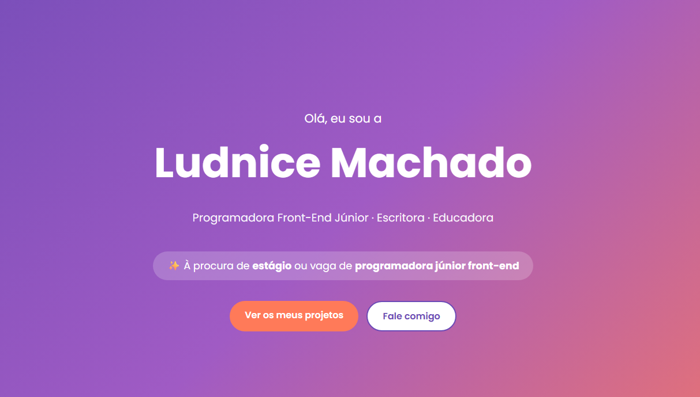

# Portfólio · Ludnice Machado ✨

Meu site pessoal, onde apresento quem sou, o que já aprendi e os projetos que criei enquanto estudo programação.

## Veja o site

[Clique aqui para abrir o meu portfólio](https://ludnice11-lang.github.io/port-folio/)

## Sobre mim

Sou educadora e escritora de livros infantis, moro em Portugal e estou em transição para a tecnologia. Estou cursando **Desenvolvimento de Software** na **Escola de Formação Sónia Monteiro**.

Procuro uma oportunidade de **estágio** ou vaga de **programadora júnior front-end**.

## O que tem no site

- **Sobre mim**: minha história e o curso que estou fazendo
- **O que já aprendi**: as linguagens e ferramentas que estudei
- **Projetos**: Jogo das Letras, Bebê Livre e Guia de Códigos
- **Escritora**: meus livros publicados
- **Formação** e **Contacto**

## Tecnologias usadas

- Angular
- HTML
- CSS
- TypeScript
- GitHub Actions
- GitHub Pages

## O que aprendi

- Organizar um site em Angular, com o HTML, o CSS e os dados em arquivos separados
- Repetir blocos na página com `@for`, usando listas
- Guardar as cores em variáveis no CSS, para mudar o site todo num só lugar
- Organizar elementos com `flex` para o site funcionar no computador e no celular
- Publicar um projeto Angular no GitHub Pages com um robô do GitHub Actions
